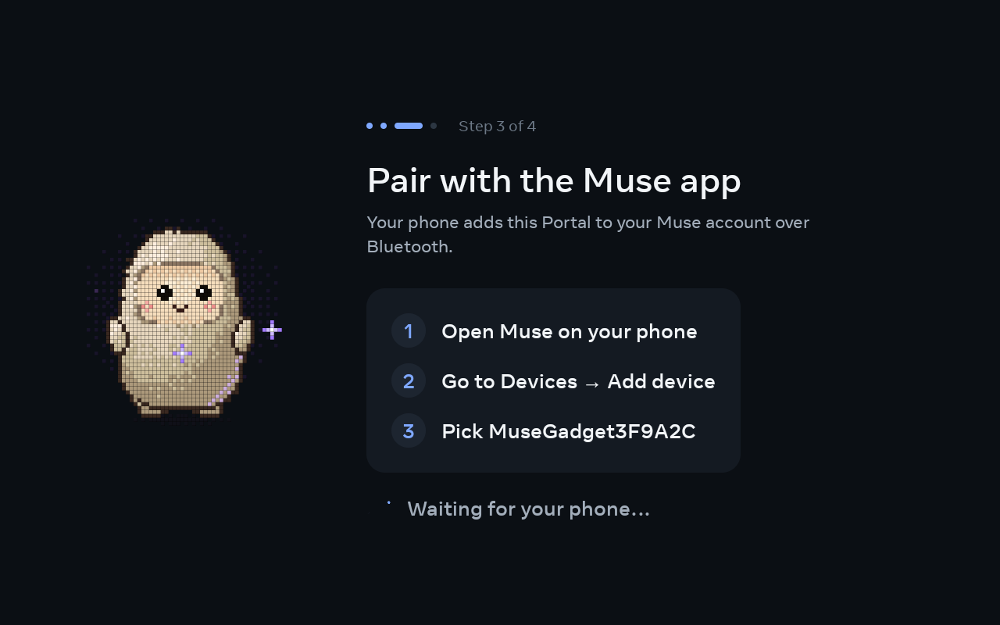
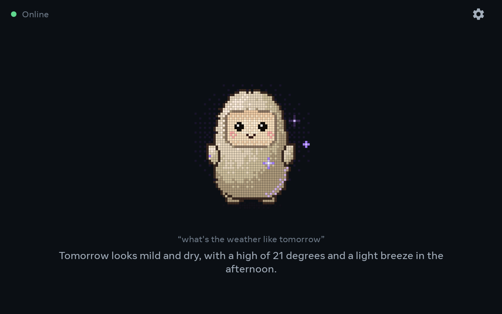
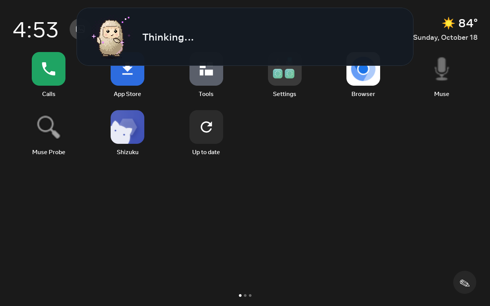
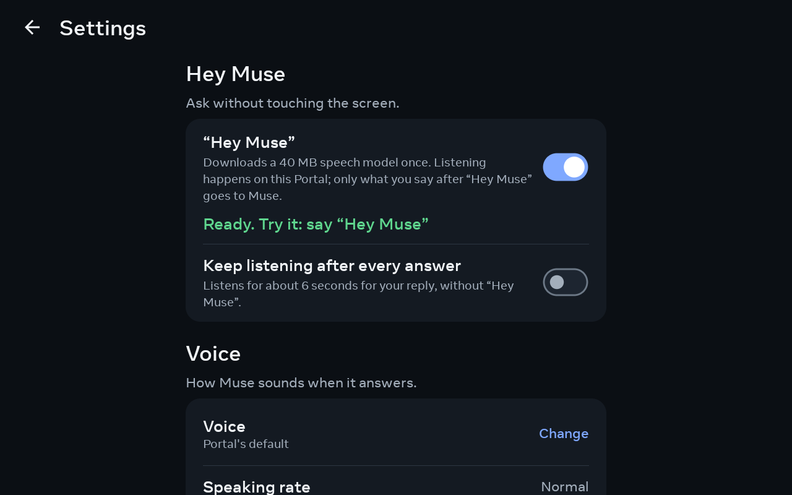

# Muse on a Meta Portal+ (Gen-1)

A field-tested manual for turning a **first-generation Meta Portal+** (Android 9) into a hands-free Muse gadget: tap to talk, or say **“Hey Muse.”**

This is **not** Meta’s official Muse Android app, and it is **not** Muse Gadget firmware flashed onto the Portal. The Portal stays Android. You sideload a community app ([portal-muse](https://github.com/wobsoriano/portal-muse)) that speaks the **Muse gadget pairing protocol** over Bluetooth LE, then you pair it from the **Muse from Meta** app on your phone.

Verified on: **Portal+**, Android **9** (API 28), build `Facebook/aloha_prod/aloha:9`, USB ADB, [Immortal](https://github.com/starbrightlab/immortal) as the home screen.

```
Phone (official Muse app)
        BLE pair + account
              |
              v
Portal+  [portal-muse]  <-- USB ADB only for install
   mic, speaker, screen, "Hey Muse"
              |
              v
         Muse cloud / VMs
```

---

## What works, and what does not

| Approach | On a Portal+? |
|---|---|
| Flash ESP32 / Linux Muse Gadget SDK onto the Portal | **No.** Wrong SoC, not Linux, not ESP32. Do not try. |
| Sideload **Muse from Meta** (`com.facebook.aura`) from Play / Aurora | **No.** That app wants **Android 10+** and Play Services. Portal+ is Android 9. |
| Open muse.ai in a browser on the Portal | Chat only. No wake word, no gadget pairing. |
| Sideload **portal-muse** and pair as `MuseGadget…` | **Yes.** This is the path below. |

portal-muse is unofficial, no-root, and uses Meta’s own ADB. The bootloader stays locked. Pairing is **community pairing** (same caveats as other Muse gadgets: no manufacturer attestation). You need an **SDK token** from [gadgets.muse.ai](https://gadgets.muse.ai/settings/sdk-tokens) and you must accept the [Gadget SDK Terms](https://gadgets.muse.ai/sdk-terms).

---

## What you need

**Hardware**

- A **Meta Portal+** (this guide is Gen-1 / Android 9). Other Portal models may work if they are API 28+ and have BLE + a mic; they are untested here.
- A **USB-C cable that carries data**, not charge-only.
- A **Mac** (this write-up) or any machine that can run `adb` and Android Gradle. Linux is fine; Windows should work with the same SDK.
- Your **phone** with the official **Muse from Meta** app, already signed in. Pairing happens on the phone.

**Accounts / tokens**

- A Muse account on the phone.
- An SDK token (`mgst_…`) from [gadgets.muse.ai → SDK tokens](https://gadgets.muse.ai/settings/sdk-tokens). Every gadget needs one. **Do not commit the token to git.**

**On the Mac (build machine)**

| Tool | Version used when this worked |
|---|---|
| JDK | **21** (`openjdk@21`) |
| Android SDK | `platforms;android-35`, `build-tools;35.0.0` (Gradle also pulled 36) |
| Gradle | wrapper **9.8.1** (ships with portal-muse) |
| portal-muse | built from source (`applicationId` `dev.wobsoriano.museportal`, `minSdk 28`) |
| Immortal kit | [starbrightlab/immortal](https://github.com/starbrightlab/immortal) `provisioning/` |

You do **not** need Android Studio. You **do** need a JDK and the SDK platforms.

---

## Overview of the work

1. Enable ADB on the Portal and connect USB.
2. Provision **Immortal** so you can sideload apps (verifier off, installer dialog fixed on Gen-1).
3. Build **portal-muse** from source.
4. `adb install -g` it, inject the SDK token, turn on Hey Muse.
5. Pair from the phone while BLE pairing is open (10 minutes).
6. Talk to Muse on the Portal.

USB is only for setup. After pairing, the cable can come out.

---

## Part 1 — ADB on the Portal

On the Portal: **Settings → Debug → ADB Enabled** (path varies slightly: look under Debug / Developer / System). Leave it on.

Plug in the USB-C **data** cable.

On the Mac:

```bash
# Immortal’s kit will download Google platform-tools if you don’t have adb.
# After the kit has run once, this path exists:
ADB="$HOME/immortal-provision/provisioning/platform-tools/adb"
# or whatever folder you cloned immortal into:
# ADB="$HOME/src/immortal/provisioning/platform-tools/adb"

$ADB devices -l
```

You want a line like:

```
<serial>    device usb:… product:aloha_prod model:Portal_ device:aloha
```

### If the list is empty but the Portal is plugged in

On macOS, Chrome (WebUSB / Inspect) often takes **exclusive USB ownership**. Check:

```bash
ioreg -p IOUSB -l -w 0 | grep -A40 'Portal'
```

If you see `UsbExclusiveOwner = "pid …, Google Chrome"`, quit Chrome (or whatever owns it), then:

```bash
$ADB kill-server
$ADB start-server
$ADB devices -l
```

A charge-only cable also produces an empty list. Swap to a cable that can transfer files.

### If the device is `unauthorized`

The Portal is showing **Allow USB debugging?** Tap **Allow**, and tick **Always allow from this computer**. Then:

```bash
$ADB reconnect
$ADB devices -l
```

`unauthorized` means this Mac’s RSA key (`~/.android/adbkey`) is not accepted yet. Allowing a *previous* computer or a WebUSB session does not authorize this `adb`.

Confirm the model:

```bash
$ADB shell getprop ro.product.model    # Portal+
$ADB shell getprop ro.build.version.release   # 9
$ADB shell getprop ro.build.version.sdk       # 28
```

---

## Part 2 — Immortal (one-time, so sideloading works)

Stock Portal software blocks random APKs. Immortal disables Meta’s package verifier, fixes the Gen-1 white-on-white installer dialog, and gives you a usable home screen.

```bash
git clone --depth 1 https://github.com/starbrightlab/immortal.git ~/immortal-provision
cd ~/immortal-provision/provisioning
```

For a non-interactive run, set these in `config.env` **before** you start (blank values make the script wait on stdin):

```bash
# Block Meta OTAs so a future update cannot undo sideloading (reversible via --restore).
DISABLE_OTA=true

# Skip Alexa unless you want it. You can add it later with ./provision.sh --alexa
RESTORE_ALEXA=false
```

On macOS, clear quarantine on the double-click wrappers if you use them:

```bash
xattr -d com.apple.quarantine Provision-Portal.command Restore-Portal.command 2>/dev/null || true
```

Run:

```bash
chmod +x provision.sh
./provision.sh
```

If `adb` is missing, the script downloads Google’s official platform-tools into `provisioning/platform-tools/`. Use **that** binary afterward.

When the Portal prompts, tap **Allow USB debugging**. Wait until you see **Done.**

Verify:

```bash
./provision.sh --status
```

You want at least:

- home: `com.immortal.launcher`
- verifier: disabled
- installer dialog: fixed (overlay disabled) — Gen-1
- client: installed
- OS updates: disabled (if you set `DISABLE_OTA=true`)

The cable is no longer required for day-to-day Immortal use. Keep it for installing Muse.

Shizuku is started during provision. Useful for Aurora later; **not required** for portal-muse.

Undo everything Immortal did: `./provision.sh --restore`.

---

## Part 3 — Build portal-muse

### 3.1 JDK 21

macOS with Homebrew:

```bash
brew install openjdk@21
export JAVA_HOME="/opt/homebrew/opt/openjdk@21/libexec/openjdk.jdk/Contents/Home"
export PATH="$JAVA_HOME/bin:$PATH"
java -version   # 21.x
```

(On Intel Homebrew, `JAVA_HOME` is under `/usr/local/opt/openjdk@21/…`.)

### 3.2 Android command-line SDK

```bash
brew install --cask android-commandlinetools
export ANDROID_HOME="/opt/homebrew/share/android-commandlinetools"
export ANDROID_SDK_ROOT="$ANDROID_HOME"

yes | sdkmanager --sdk_root="$ANDROID_HOME" --licenses
sdkmanager --sdk_root="$ANDROID_HOME" "platforms;android-35" "build-tools;35.0.0"
```

### 3.3 Clone and assemble

```bash
git clone --depth 1 https://github.com/wobsoriano/portal-muse.git ~/portal-muse
cd ~/portal-muse/android
printf 'sdk.dir=%s\n' "$ANDROID_HOME" > local.properties
chmod +x gradlew
./gradlew :app:assembleDebug --no-daemon
```

Success looks like:

```
BUILD SUCCESSFUL
```

APK path:

```
~/portal-muse/android/app/build/outputs/apk/debug/app-debug.apk
```

(~40 MB debug build.) Native libs (`libvosk.so`, etc.) may warn that they could not be stripped. That is normal.

You can also run the repo’s test set (`:muse:test :wake:test :app:testDebugUnitTest`) if you want extra confidence. It is not required to install.

---

## Part 4 — Install on the Portal and inject the token

Still on USB, with `adb` authorized:

```bash
ADB="$HOME/immortal-provision/provisioning/platform-tools/adb"
APK="$HOME/portal-muse/android/app/build/outputs/apk/debug/app-debug.apk"

$ADB install -g "$APK"
```

`-g` grants runtime permissions at install (mic, location, …). Extra grants that are useful:

```bash
$ADB shell pm grant dev.wobsoriano.museportal android.permission.RECORD_AUDIO
$ADB shell pm grant dev.wobsoriano.museportal android.permission.ACCESS_FINE_LOCATION
$ADB shell pm grant dev.wobsoriano.museportal android.permission.BLUETOOTH
$ADB shell pm grant dev.wobsoriano.museportal android.permission.BLUETOOTH_ADMIN
```

`SYSTEM_ALERT_WINDOW` (overlay bar on Immortal) is granted with `-g` on this device.

**Do not type the SDK token on the Portal keyboard.** The debug build accepts extras:

```bash
# Replace the token. Do not commit this command to a public gist with a real token.
$ADB shell am start -n dev.wobsoriano.museportal/.MainActivity \
  --es sdkToken 'mgst_YOUR_TOKEN_HERE' \
  --es name 'Portal+' \
  --ez heyMuse true
```

What those extras do (from `MainActivity`):

| Extra | Effect |
|---|---|
| `sdkToken` | Saved into app prefs (`sdkToken`) |
| `name` | How this Portal shows up |
| `heyMuse` | Turns the wake-word listener on |

First time Hey Muse is enabled, the app downloads Vosk `vosk-model-small-en-us-0.15` (~41 MB, SHA-256 pinned) into its files dir, then starts listening.

Confirm it is in front and not crashing:

```bash
$ADB shell dumpsys activity activities | grep mResumedActivity
# expect: dev.wobsoriano.museportal/.MainActivity

$ADB logcat -s MuseWake:I MuseCore:I
```

Healthy log lines look like:

```
MuseCore: pairing open name=MuseGadgetXXXXXX for=10m
MuseWake: Downloaded -> Loading
MuseWake: model loaded in … ms
MuseWake: EngineLoaded -> Listening
```

Note the **`MuseGadget……`** name. Pairing stays open **10 minutes**. If you miss it, launch the app on the Portal again, or re-run the `am start` command.

---

## Part 5 — Pair from the phone

Do this while logcat still says pairing is open.

1. Phone: open **Muse from Meta**.
2. **Settings → Devices → Developer mode** — turn **on**.
3. **Add Device** (the **+**).
4. Choose **`MuseGadgetXXXXXX`** (the name from logcat).
5. Accept the **community device** warning. It is yours.
6. When asked for Wi-Fi: the Portal is already on the network. You should not need a password.

After that, the Portal stays connected across reboots (portal-muse has a boot receiver; Hey Muse runs as a foreground service when enabled). USB can be unplugged.

To pair again later, open Muse on the Portal (or `am start` without wiping prefs) so it re-opens BLE pairing.

---

## Part 6 — Use it

- **Tap** the Muse avatar / button on the Portal to ask.
- Or say **“Hey Muse”** once the listener shows Listening.
- Answers are spoken on the Portal speaker. While another app is using the mic, portal-muse yields; if [portal-wake](https://github.com/rudysev/portal-wake) is installed, it registers the phrase there instead of holding the mic itself.
- From another app, a bar can overlay the turn (`SYSTEM_ALERT_WINDOW`).

Pairing state lives in the app’s files as `muse.json`. Reinstalling the **same** debug package without uninstalling keeps pairing. `adb uninstall dev.wobsoriano.museportal` wipes it — you will pair again.

---

## Screenshots

What portal-muse looks like on a Portal+ (Gen-1).

| Step 1: SDK token | Step 2: Name | Step 3: Pair | Step 4: Hey Muse |
|---|---|---|---|
|  |  |  |  |

| Ready | Answered | Overlay bar |
|---|---|---|
|  |  |  |

| Settings | Settings (cont.) | Settings (cont.) |
|---|---|---|
|  |  |  |

---

## Troubleshooting

### `adb devices` empty, ioreg shows Portal+

Chrome (or another WebUSB client) has `UsbExclusiveOwner`. Quit that process, `adb kill-server && adb start-server`.

### `unauthorized`

Tap **Allow** on **this** computer’s RSA prompt. `~/.android/adbkey` is the key.

### Official Muse APK won’t install

`minSdk` is 29 (Android 10). Portal+ is 28. Use portal-muse, not `com.facebook.aura`.

### Pairing window missed

```bash
$ADB logcat -c
$ADB shell am start -n dev.wobsoriano.museportal/.MainActivity
$ADB logcat -s MuseCore:I
```

Wait for `pairing open name=MuseGadget… for=10m`, then add the device on the phone.

### Hey Muse never reaches Listening

Watch `MuseWake`. It should go `Downloading` → `Downloaded` → `Loading` → `Listening`. Needs network the first time (41 MB model). To skip the download, push a local copy of `vosk-model-small-en-us-0.15` as described in the [portal-muse README](https://github.com/wobsoriano/portal-muse).

### App not on screen after install

```bash
$ADB shell am start -n dev.wobsoriano.museportal/.MainActivity
```

Or open **Muse** from Immortal’s app list.

### Want Alexa on the same Portal

Immortal can restore first-gen Alexa separately (`./provision.sh --alexa`). Wake-word apps fight over the mic; portal-muse yields when another app records, but two always-on listeners is still messy. Pick one as the default wake word.

### Uninstall Muse from the Portal

```bash
$ADB uninstall dev.wobsoriano.museportal
```

Immortal is unchanged.

### Uninstall Immortal / stock launcher back

```bash
cd ~/immortal-provision/provisioning
./provision.sh --restore
```

---

## Security notes (read this before you publish a fork)

- The SDK token is a **secret**. Inject it with `am start --es sdkToken`, never bake it into the APK, never commit it, never paste it into a public issue.
- Community BLE pairing has **no manufacturer verification** and does not stop an active MITM. Pair on a network you trust.
- portal-muse ports the gadget protocol (Apache 2.0 via Meta’s SDK / hey-muse). The default avatar (“Jollybot”) is **not** covered by that Apache license; see portal-muse’s README if you ship screenshots or a fork.
- This manual describes **your own device**. Do not run these steps against a Portal you do not own.

---

## Command cheat sheet

```bash
export JAVA_HOME="/opt/homebrew/opt/openjdk@21/libexec/openjdk.jdk/Contents/Home"
export ANDROID_HOME="/opt/homebrew/share/android-commandlinetools"
export PATH="$JAVA_HOME/bin:$PATH"
ADB="$HOME/immortal-provision/provisioning/platform-tools/adb"

# Immortal
cd ~/immortal-provision/provisioning && ./provision.sh --status

# Build
cd ~/portal-muse/android && ./gradlew :app:assembleDebug

# Install + configure
$ADB install -g ~/portal-muse/android/app/build/outputs/apk/debug/app-debug.apk
$ADB shell am start -n dev.wobsoriano.museportal/.MainActivity \
  --es sdkToken 'mgst_…' --es name 'Portal+' --ez heyMuse true

# Watch pairing
$ADB logcat -s MuseCore:I MuseWake:I
```

---

## Links

- [portal-muse](https://github.com/wobsoriano/portal-muse) — the Portal app
- [Immortal](https://github.com/starbrightlab/immortal) — Portal launcher / sideload kit
- [Immortal provisioning walkthrough](https://starbrightlab.github.io/immortal/provisioning/)
- [Muse Gadget SDK](https://github.com/facebookincubator/muse-gadget-sdk) — ESP32 / Linux gadgets (not the Portal)
- [gadgets.muse.ai](https://gadgets.muse.ai/) — SDK tokens
- [hey-muse](https://github.com/wobsoriano/hey-muse) — gadget protocol port used by portal-muse
